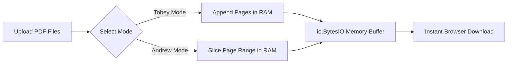

<div align="center">

# 🕸️ Spidey PDF Tool

**Fast, in-memory PDF merger and splitter built with Python & Streamlit.**

<p>
  
  
  
  
</p>

[Features](#-features) • [Architecture](#-how-it-works) • [Quick Start](#-quick-start) • [Roadmap](#-roadmap)

</div>

---

## 📌 Overview

Most online PDF tools are slow, filled with ads, or upload private files to unknown servers. **Spidey PDF Tool** solves this by processing PDFs directly inside your system's RAM (`io.BytesIO`)—keeping everything fast, local, and private, wrapped in a Spider-Man multiverse interface.

---

## ⚡ Features

| Agent Mode | Action | What It Does |
| :--- | :--- | :--- |
| 🍕 **Tobey Mode** | **Merge PDFs** | Combines multiple uploaded PDF files into a single clean document in seconds. |
| ⚡ **Andrew Mode** | **Split PDF** | Extracts a specific page range (`start` to `end`) with built-in input validation. |
| 🕷️ **Tom Mode** | **Session Reset** | Clears active memory state and resets the workspace with a single click. |

---

## 🧠 How It Works



* **Zero Disk Storage:** No temporary files are written to your hard drive.
* **Safe Page Slicing:** Automatically validates page numbers so out-of-range inputs never crash the app.

---

## 🚀 Quick Start

```bash
# 1. Clone the repository
git clone https://github.com
cd spidey-pdf-tool

# 2. Install required packages
pip install streamlit pypdf

# 3. Start the application
streamlit run main.py
```

<details>
<summary><b>📂 Click to view Project Structure</b></summary>

```text
spidey-pdf-tool/
├── main.py          # Core Streamlit UI & PyPDF logic
└── README.md        # Project documentation
```
</details>

---

## 🗺️ Roadmap

- [ ] Add PDF compression to reduce large file sizes
- [ ] Support custom page reordering before merging
- [ ] Add password encryption for sensitive PDFs
- [ ] Deploy live web demo on Streamlit Community Cloud

---

<div align="center">

**"With great power comes great responsibility."**

Built by **[Sufyan-m](https://github.com)**

</div>
